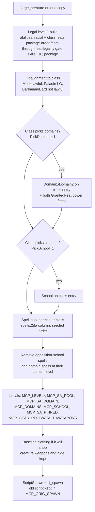
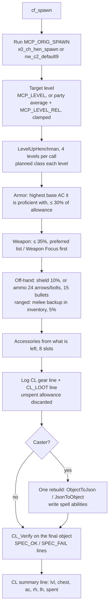

# Creature Forge Manual

How the creature tools work, how to use them by hand, how the model uses them inside `/create-adventure`, and the
logic each one follows. Design history and the engine findings behind the rules are in
[`creature-forge-spec.md`](creature-forge-spec.md). Last updated 2026-11-07.

## In short

- **Class-based creatures** (anything with Fighter, Cleric, Wizard and the other player classes) are built with two
  calls: `create_creature_level_system` once per module, then `forge_creature` on each blueprint and each placed copy.
  The forge writes a legal level-1 build; the creature levels itself, shops for gear and gets its spells when it spawns,
  then checks itself and logs the result.
- **Companions** use `create_companion_system` once per module and `create_companion_dialog` per companion, on top of the
  forge.
- **Themed boss fights** can be built in one call with `compose_encounter`, which forges the boss and places palette
  monsters as support.
- **Monsters** (Animal, Beast, Undead, Outsider and other non-player classes) are not forged. Place a ready-made palette
  creature as it is.
- **Proof** comes from `run_live_verification`, which runs the module on a real headless engine and returns every
  creature's `[SPEC_OK]`/`[SPEC_FAIL]` checks and a `[CL_LOOT]` line listing what it bought.

## The tools

| Tool | When | What it does |
|---|---|---|
| `create_creature_level_system` | Once per module, and again after changing stores | Writes `inc_cre_level` (all spawn-time logic) and `cf_spawn` (the spawn wrapper), compiles them. |
| `forge_creature` | Per blueprint and per placed copy | Legal level-1 build, levelling plan, spell pool, domains/school, gear settings, spawn wiring. |
| `create_companion_system` | Once per module with companions | Shared recruit, dismiss and order scripts. |
| `build_companion` | Per companion (replaces the three rows around it) | One call: blueprint, forge, placement, recruit dialog and a `verify_creature` pass. See [adventure-tooling-reference.md](adventure-tooling-reference.md) §4. |
| `create_companion_dialog` | Per companion | Four-root dialog, set as the Conversation of the blueprint and every placed copy. |
| `compose_encounter` | Per themed boss fight | Plans or builds a forged Hostile boss plus enough palette minions to reach a target Encounter Level. |
| `run_live_verification` | After building | Runs the module headless, returns the in-game checks, loot lines and engine errors. |
| `generate_weapon_packages`, `sanitize_feat_package` | When authoring NPC packages | Per-weapon `packages.2da` feat tables (`NPCpackages/`); not part of the forge itself. |

## Using the tools by hand

### 1. Once per module: `create_creature_level_system`

| Parameter | Default | Meaning |
|---|---|---|
| `stores` | four base-game stores | JSON array of store tags or resrefs NPCs buy from. A tag matches a store already placed in the module; otherwise the resref is spawned once and reused. Default `nw_storeweap001`, `nw_storgenral001`, `nw_storemagic001`, `nw_storetmple001`. |
| `droppable` | `true` | Whether bought gear can drop as loot. |

Re-run it after changing the store list, or after updating the MCP server (the generated script changes with it), then
repack.

### 2. Per creature: `forge_creature`

Call it on the blueprint (`resref`) and again on each placed copy (`area` + `tag`): a placed creature is a separate copy
of its blueprint. Identity is left alone: name, appearance, faction, dialog, soundset, death script, plot flags.

| Parameter | Default | Meaning |
|---|---|---|
| `resref`, or `area` + `tag` | required | Which copy to change. |
| `race` | required | `racialtypes.2da` row (0 Dwarf, 1 Elf, 2 Gnome, 3 Halfling, 4 Half-Elf, 5 Half-Orc, 6 Human). |
| `classId` | required | First class (0 Barbarian, 1 Bard, 2 Cleric, 3 Druid, 4 Fighter, 5 Monk, 6 Paladin, 7 Ranger, 8 Rogue, 9 Sorcerer, 10 Wizard). |
| `level` | 0 | Absolute target level. **Use this for anything placed in an area**: placed creatures spawn at module load, before any player exists. |
| `levelRel` | 0 | Offset from the party's average level at spawn; only for creatures created later by script or encounter. |
| `levelMin`, `levelMax` | none | Clamp for `levelRel`. |
| `plan` | single class | JSON array of class ids, one per level, for multiclass order, e.g. `[4,4,4,6,6]`. |
| `powerLevel` | `elite` | Ability-score band. `tougher` or `epic` only for bosses. |
| `complexity` | `full` | `simple` = required feats only (minions, commoner-tier). |
| `gearRole` | `standard` | Share of the level's wealth: `pc` and `elite` 100 %, `standard` 50 %, `mook` 25 %. |
| `gearWealth` | 0.5 | Multiplier on that share. `0` keeps the creature's current gear and skips shopping (use for a plot item). |
| `weapons` | class preference | JSON array of `baseitems.2da` rows to look for first. |
| `pinnedSpells` | none | JSON array of `spells.2da` rows a caster always gets first at their spell level (a boss's signature spell). A spell not on the creature's class list is ignored with a warning. |
| `domains` | package's | **Cleric**: two `domains.2da` rows (0 Air, 1 Animal, 3 Death, 4 Destruction, 5 Earth, 6 Evil, 7 Fire, 8 Good, 9 Healing, 10 Knowledge, 13 Magic, 14 Plant, 15 Protection, 16 Strength, 17 Sun, 18 Travel, 19 Trickery, 20 War, 21 Water). Default from the package: Healing and Sun. Choose from the character. |
| `school` | package's | **Wizard**: `spellschools.2da` row (0 General, 1 Abjuration, 2 Conjuration, 3 Divination, 4 Enchantment, 5 Evocation, 6 Illusion, 7 Necromancy, 8 Transmutation). Default General. |
| `originalSpawn` | current ScriptSpawn | Script the wrapper runs first: `x0_ch_hen_spawn` for companions, `nw_c2_default9` otherwise. |

```
forge_creature(resref: "boss_venn", race: "6", classId: "2", level: "6", gearRole: "elite",
               powerLevel: "tougher", domains: "[6, 19]", originalSpawn: "nw_c2_default9")
forge_creature(area: "grayward_hall", tag: "boss_venn", race: "6", classId: "2", level: "6", gearRole: "elite",
               powerLevel: "tougher", domains: "[6, 19]", originalSpawn: "nw_c2_default9")
```

The result lists the level-1 feats, spell-pool sizes per level, the gear setting, domains or school, and any warnings.
`levelOneFeats` is the stat block before domain power feats are added; the in-game check confirms those.

### 3. Companions: `create_companion_system` and `create_companion_dialog`

1. `create_companion_system()` once (`maxCompanions`, default 3, counts the whole party, all players combined).
2. Per companion: `create_creature_blueprint` (identity only, `henchman: true`, faction 2), `place_creature`, then
   `forge_creature` on both copies with `gearRole: "pc"` and `originalSpawn: "x0_ch_hen_spawn"`.
3. `create_companion_dialog(creature, introduction, backstory, …)`. You write the character's lines (`introduction`,
   `backstory`, `accept`, `farewell`, `partyFull`, `inParty`, `stay`, `follow`, `fallback`); the order lines and scripts are
   fixed. Pass `replace: true` to rebuild an existing dialog.

The companion keeps the stock `x0_ch_hen_*` scripts for everything else, including `x0_ch_hen_death` and
`x0_ch_hen_combat`. Don't add death or end-round wrappers.

### 4. A boss fight in one call: `compose_encounter`

`compose_encounter(role, bossCR, targetEL, partyLevel, area)`. Without `area` it only plans: the boss's class and level,
whether the boss alone reaches `targetEL`, and if not how many of which palette minion close the gap. With `area` it
builds a Hostile boss, forges it (`gearRole: elite`, `powerLevel: tougher`), writes the level system if the module lacks
it, places the boss and minions on open ground and runs `verify_creature` on the boss. Move the creatures afterwards if
the spots don't suit the story; call `forge_creature` again for pinned spells, domains or a plot item.

### 5. Checking the result

- `verify_creature` / `verify_all`: static checks. Forged creatures pass; the checks recognise the forge's locals.
- `run_live_verification`: the real proof. It waits until every forged creature has finished (see the flow below), then
  returns `specResults.ok/fail`, the `[CL]` summary and `[CL_LOOT]` lines, and engine errors. Fix any `[SPEC_FAIL]`
  before reporting success.
- `get_object_variables` on a placed creature shows what it will do at spawn.

## How the model uses them

In `/adventure-actors` and `/adventure-challenges` the model's work is deciding a short spec per creature from the story,
then making the calls:

1. **Spec from the plot:** who (name, race, gender, look, faction, dialog); what (class from the role, level from the
   encounter design, `gearRole` from importance: companion `pc`, boss or named leader `elite`, rank and file `standard`,
   fodder `mook`); flavour (a named weapon, a signature spell, a Cleric's two domains, a Wizard's school).
2. **Once per module:** `create_creature_level_system`, naming any themed stores; `create_companion_system` if there
   are companions.
3. **Identity:** `create_creature_blueprint` with no stats, feats, spells or equipment; `place_creature`.
4. **Forge both copies** with the spec. Companions also get `create_companion_dialog`.
5. **Monsters:** pick a palette creature and place it; don't forge it.
6. **Check:** `verify_creature` on each, then `run_live_verification` once per phase; `/adventure-rewards` reads the
   `[CL_LOOT]` lines to see what each creature will drop.

The model no longer looks up feat or spell IDs, computes HP, skills or ability arrays, chooses armor by tier, sources
items, budgets gold, writes spell or companion scripts, or bakes spell pools. Those steps produced almost every creature
bug reported in earlier modules.

## Logic flow

### At build time (`forge_creature`)



1. **Level-1 build.** Ability scores from the power band; racial and automatic class feats; generic and bonus feats in
   the class package's order (`packft_*.2da`), each passing `feat-legality.ts` (prerequisite feats, base attack, abilities,
   spell level, saves, skills, class access). Skills, HP, starting package. Challenge rating is set from the target level.
2. **Alignment** is moved inside the class's restriction, because `LevelUpHenchman` silently refuses a level the
   alignment doesn't allow.
3. **Domains** (any class with `PickDomains=1`): requested pair, else the package's `Domain1/Domain2`. Written on the class
   entry; both domains' `GrantedFeat` power feats go into the level-1 feats (the engine adds feats only from level 2).
4. **School** (any class with `PickSchool=1`): requested row, else the package's `School`. Written on the class entry.
5. **Spell pool** per caster class: every spell on the class's `spells.2da` column, by spell level, in a seeded order. A
   specialist's opposition school (`spellschools.2da Opposition` → `Letter`, matched to `spells.2da School`) is removed.
   Domain spells are added at their domain level and removed from any other level, so each spell has one level.
6. **Locals** record the plan for the spawn script (table in "Locals" below).
7. **Gear:** with an allowance, the chest slot gets baseline clothing so the creature is never naked before it shops.
8. **Spawn wiring:** `ScriptSpawn` becomes `cf_spawn`.

### At spawn (`cf_spawn` → `inc_cre_level`)



1. **Original spawn script** runs first, so stock AI flags and companion setup are unchanged.
2. **Target level:** `MCP_LEVEL` if set, else the party's average level plus `MCP_LEVEL_REL`, clamped.
3. **Levelling:** `LevelUpHenchman` four levels per call (each call is its own script run, to stay under the instruction
   limit), taking the class from `MCP_LEVEL_PLAN` at each level. From a valid level 1 it adds every automatic feat and
   no illegal one.
4. **Shopping**, one step per delayed call. The allowance is the level's wealth × role share × `gearWealth`. Each step
   scans the stores for the best item the creature can use (proficiency, class, race and alignment limits; the engine
   refuses to equip anything else), within its share:
   - armor (≤ 30 %): highest base AC it is proficient with;
   - weapon (≤ 35 %): preferred weapons and held Weapon Focus feats first;
   - off-hand: a shield (≤ 10 %) for a one-handed melee weapon with shield proficiency, or ammunition for a ranged
     weapon; **ranged creatures also buy a melee backup** (≤ 5 %, at least 15 gp) kept unequipped, so the stock AI can
     switch when ammo runs out;
   - accessories: eight slots from whatever is left.
   Every purchase is logged in one `[CL_LOOT] tag= resref= area= droppable= items=resref@slot[xstack]:gp,…` line.
   Unspent allowance is discarded, never given as gold.
5. **Spell abilities** (casters): one rebuild via `ObjectToJson`/`JsonToObject` keeps tag, locals, HP and effects and
   writes the special-ability list. Per class and spell level:
   - **slots** = `cls_spgn_*` base + ability bonus (one at spell level n when the casting modifier ≥ n, plus one per 4
     above) + **specialist slot** at spell levels 1–9 when the creature has a school;
   - **distinct spells** = slots, capped by the known-spell table (Bard, Sorcerer) and the pool size;
   - **picked in order:** the **domain slot** (one of this level's domain spells), then **pinned spells**, then the pool
     from a random start, skipping duplicates; repeats fill the remaining slots;
   - **caster level** = class level (one ready entry is one cast).
6. **Checks** (`CL_Verify`, on the rebuilt object), each a `[SPEC_OK]`/`[SPEC_FAIL]` line — see the table below.
7. **Summary:** `[CL] tag lvl= chest= ac= rh= lh= spent=`.

### Companions

- `c_hen_mine`: the speaker leads this companion. `c_hen_full`: free, but the speaker's party already has
  `maxCompanions` living companions. `c_hen_free`: free.
- The party count is computed from the engine at join time: living henchmen whose master is a player, across the
  recruiting player's whole party. There is no counter, so dismissal, death and raising can never leave it wrong.
- `a_hen_join`: if there's room, raise `SetMaxHenchmen` (`AddHenchman` is a silent no-op below the cap), set listen
  patterns (without them the companion ignores every order), `AddHenchman`, then send the follow order so a stand-ground
  order from before a dismissal doesn't stick.
- `a_hen_leave`: `RemoveHenchman`, back to the Commoner faction. `a_hen_stay` / `a_hen_follow`: the stock associate AI's
  silent shouts.
- Dialog roots, first true wins: in party → party full → free → unconditional fallback.

### `run_live_verification`

1. Repack, copy the module to the verify server, point it at the module, stop and start the container.
2. Ignore any log file not written since this run started (the previous run's log is left behind by the stop).
3. Poll every second. Stop when `expectedCheckLines` tagged lines have appeared, or when the log has been quiet for
   8 seconds **and** no forged creature is mid-spawn (it logged its gear line but not its final `[CL] … lvl=` line), or at
   the timeout.
4. Always stop the container, then parse the log into engine errors, `[SPEC_*]` results and other tagged lines.

## In-game checks

| Check | Passes when |
|---|---|
| `cl_level` | Hit dice equal the target level. |
| `cl_class_<class>` | Levels in each class match the plan (multiclass only). |
| `cl_spell_slots` | Ready abilities per class and spell level equal the computed slots. |
| `cl_spell_validity` | Every ability is on one of the creature's class lists (or its domains) at a level it can cast, at the right caster level. |
| `cl_spell_pinned_<id>` | Each pinned spell is present. |
| `cl_spell_domain_<class>` | At every spell level with domain spells and slots, at least one ready ability is a domain spell. |
| `cl_domain_<class>` | `GetDomain` returns the planned two domains. |
| `cl_domain_feats_<class>` | Both domain power feats are present. |
| `cl_school_<class>` | `GetSpecialization` returns the planned school. |
| `cl_school_opposition_<class>` | No ready ability is from the opposition school. |
| `cl_gear_chest`, `cl_gear_weapon` | Something is equipped in the chest and right hand. |
| `cl_gear_melee_backup` | A ranged creature carries a usable melee weapon. |
| `cl_gear_no_gold` | Gold is the same before and after shopping. |

## Locals written by the forge

| Local | Meaning |
|---|---|
| `MCP_LEVEL`, `MCP_LEVEL_REL`, `MCP_LEVEL_MIN`, `MCP_LEVEL_MAX` | Target level, or offset from the party average and its clamp. |
| `MCP_LEVEL_PLAN` | Comma list of class ids per level. |
| `MCP_SA_POOL` | JSON `{class: {spell level: [spell ids]}}`. |
| `MCP_SA_DOMAIN` | JSON `{class: {spell level: [domain spell ids]}}`. |
| `MCP_DOMAINS` | JSON `{class: [domain1, domain2]}`. |
| `MCP_SCHOOL` | JSON `{class: school}`. |
| `MCP_SA_PINNED` | Comma list of pinned spell ids. |
| `MCP_GEAR_ROLE`, `MCP_GEAR_WEALTH`, `MCP_GEAR_WEAPONS` | Wealth share, multiplier, preferred weapons. |
| `MCP_ORIG_SPAWN` | The spawn script `cf_spawn` runs first. |

## Engine facts the system relies on

All verified on the live engine; details in [`creature-forge-spec.md`](creature-forge-spec.md) §11 and `CLAUDE.md`.

- The engine silently refuses to equip an item the creature isn't proficient with.
- Armor base AC comes from the torso part (`parts_chest.2da`), not from item properties.
- `LevelUpHenchman` adds every automatic class feat from level 2 and no illegal feat, given a valid level 1. Level-1
  choices (domains, school, their feats) must be written at build time.
- `ObjectToJson(o, TRUE)` → `JsonToObject(…, TRUE)` keeps tag, locals, HP and effects.
- Each ready special-ability entry is one cast at its `SpellCasterLevel`.
- A specialist Wizard gets one extra slot at spell levels 1–9 and none at cantrips.
- `GetDomain` / `GetSpecialization` read the class entry's `Domain1`/`Domain2`/`School`.

- A caster's spell-like-ability pool never holds self-concealment spells (Darkness, Invisibility, Improved Invisibility, Invisibility Sphere,
  Sanctuary, Ethereal/Ghostly Visage): the default combat AI casts self-buffs first and the creature stood invisible and idle.
  `isSelfConcealmentSpell` in `creature-forge-tools.ts`; a `pinnedSpells` entry is the only way back.
- A creature with a spell-ability pool (`MCP_SA_POOL`) levels with `bReadyAllSpells` FALSE; with it TRUE it also had every memorized spell
  ready, a second spellbook on top of the pool.
- `MCP_GEAR_WEALTH` (`gearWealth`) is a multiplier on the role's gold budget, default 0.5, 0 keeps the current gear. It is a local on the
  blueprint and on each placed copy.

## Limits

- Monster classes and Commoner are not forged; use palette creatures.
- A class gained after level 1 in a multiclass plan gets its package's domains or school, not the requested ones (the
  forge warns).
- Gear is chosen at spawn, so only the `[CL_LOOT]` lines from a live run show what a creature carries.
- Stores must be base-game resrefs, resrefs in the module or its HAKs, or placed stores with that tag.
- Companion recruiting, dialog and party limits can't be tested on the headless server (it has no player); test them
  in game.
